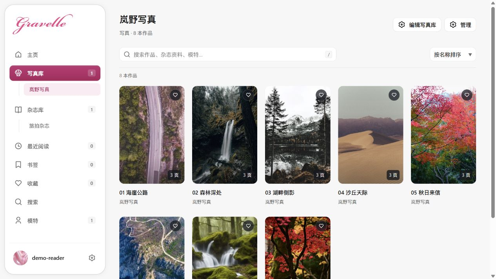

<div align="center">


**属于你自己的写真库阅读器**

写真与杂志库 · 以图搜图 · 单本分享

[](https://github.com/pumpkissster/Gravelle/releases/latest)
[](https://hub.docker.com/r/pumpkissster/gravelle)
[](LICENSE)

[桌面下载](https://github.com/pumpkissster/Gravelle/releases/latest) · [Docker 部署](docs/docker-release.md) · [使用文档](#使用文档) · [反馈问题](https://github.com/pumpkissster/Gravelle/issues)

</div>

---

Gravelle 把本地写真和杂志整理成可在浏览器阅读的书架。支持 Windows、macOS 和 Docker，同一账号可以在电脑、手机和平板上接着读。

<picture>
  <source media="(prefers-color-scheme: dark)" srcset="docs/screenshots/library-dark.jpg">
  
</picture>

<sub>Board 主题的示例写真库，演示照片来自 <a href="https://www.pexels.com/license/">Pexels</a>。</sub>

## 功能亮点

| 功能 | 用法 |
| --- | --- |
| **写真与杂志分库** | 把不同目录整理成独立的库，拖拽调整顺序。杂志可以录入简介和目录，也能按文字搜索。 |
| **以图搜图** | 用完整截图或轻中度裁剪的图片，在自己的写真库里找原图。 |
| **多种阅读方式** | 阅读图片文件夹、ZIP／CBZ、PDF 和图片型 EPUB。支持单页、双页和连续滚动，进度、书签与收藏随账号同步。 |
| **单本分享** | 管理员可以为单本作品创建带密码的分享，设置 1、3 或 7 天有效期，查看访问统计和关闭分享。 |
| **图片优化与权限** | 可按规则生成优化副本并保留原图。为子账号单独授权写真库，阅读记录按账号保存。 |

<details>
<summary>查看格式说明</summary>

- 杂志库可读取单卷、未加密的 RAR，单页上限为 128 MiB。RAR 支持按页阅读和分享。
- EPUB 面向图片写真集。加密 PDF、DRM EPUB 和纯文字 EPUB 超出支持范围。PDF、EPUB 和 RAR 暂不参加图片优化和以图搜图。

</details>

## 快速安装

| 平台 | 安装方式 |
| --- | --- |
| Windows 10（1809+）／11 x64 | 从 [发行页](https://github.com/pumpkissster/Gravelle/releases/latest) 下载安装程序，或解压便携 ZIP 后打开 `Gravelle.exe`。 [Windows 使用说明](docs/windows.md) |
| macOS 15 及以上 | 从 [发行页](https://github.com/pumpkissster/Gravelle/releases/latest) 下载 DMG。Apple 芯片选 `arm64`，Intel 选 `x64`。 [macOS 使用说明](docs/macos.md) |
| Docker／NAS | 使用 `pumpkissster/gravelle:latest`，支持 amd64 和 arm64。 [Docker 部署说明](docs/docker-release.md) |

桌面版在启动器里添加写真根文件夹，再点击「启动阅读器」。首次在浏览器打开时注册管理员账号，然后创建写真库。

<details>
<summary>展开 Docker Compose 示例</summary>

可将以下内容保存为 `compose.yaml`，将 `/path/to/...` 替换为实际宿主机目录。默认访问端口为 8080，可自行修改。群晖用户也可直接填入 Container Manager 的“项目”配置。

```yaml
services:
  gravelle:
    image: pumpkissster/gravelle:latest  # 使用最新版本镜像
    container_name: gravelle            # 容器名称
    user: "0:0"                        # 运行用户 UID:GID，按目录权限调整
    ports:
      - "8080:8080"                    # 左侧为宿主机访问端口，可自行修改；右侧保持 8080
      # 可选：独立分享端口；需要时取消下一行注释，并在网页中开启独立分享
      # - "8081:8081"                  # 左侧宿主机端口可改；右侧容器端口固定为 8081
      # 可选：由 Gravelle 自己提供 HTTPS 时，按网络设置说明配置证书并映射 8443
      # - "8443:8443"                  # 外部反向代理提供 HTTPS 时无需启用
    restart: unless-stopped            # 除非手动停止，否则自动重启
    volumes:
      # 资料目录：保存账号、作品信息、阅读记录及缓存
      - "/path/to/data:/data"
      # 写真目录：只读挂载，不会修改原始文件；可继续添加 /library 的其他子目录
      - "/path/to/photos:/library/photos:ro"
      # 可选：把图片优化副本单独保存到其他文件夹或磁盘
      # 不启用时，副本默认保存在上方资料目录的 transcoded 子目录
      # 启用时取消下一行开头的 #，并修改左侧宿主机路径
      # - "/path/to/transcoded:/data/transcoded"
```

创建对应的宿主机文件夹后，在配置文件所在目录执行：

```sh
docker compose pull
docker compose up -d
```

镜像可选 `pumpkissster/gravelle:latest`。写真目录只读映射到 `/library` 或 `/library` 的子目录，资料目录映射到 `/data`；网页创建库时选择 `/library` 或其子目录。

在浏览器打开 `http://服务器IP:8080`，网页创建库时选择 `/library/photos`。如需独立分享端口、HTTPS 或单独挂载优化副本，可查看 [Docker 部署说明](docs/docker-release.md) 和 [网络设置](docs/network.md)。

</details>

## 使用文档

- **整理与阅读**　[杂志库](docs/magazines.md) · [PDF](docs/pdf.md) · [EPUB](docs/epub.md) · [以图搜图](docs/image-search.md)
- **服务与访问**　[用户与权限](docs/users.md) · [单本分享](docs/sharing.md) · [网络设置](docs/network.md)
- **存储与性能**　[图片优化](docs/transcoding.md) · [缓存管理](docs/cache.md) · [性能设置](docs/performance.md)

升级前，停止服务并备份完整资料目录，沿用原作品路径和挂载。各平台的资料位置和更新步骤见上面的安装说明。

## 许可

项目采用 [MIT License](LICENSE)，字体及依赖许可见 [字体授权](static/fonts/OFL.txt) 与 [第三方声明](desktop/THIRD_PARTY_NOTICES.md)。阅读交互参考了[拷贝漫画增强](https://greasyfork.org/zh-CN/scripts/421371-%E6%8B%B7%E8%B4%9D%E6%BC%AB%E7%94%BB%E5%A2%9E%E5%BC%BA)的使用体验，项目代码独立实现。
